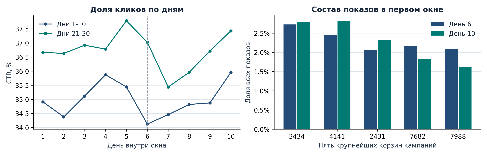
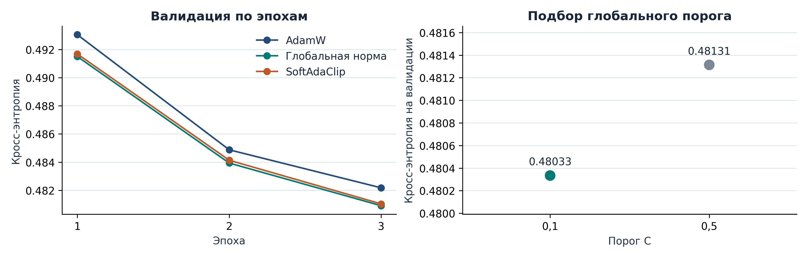
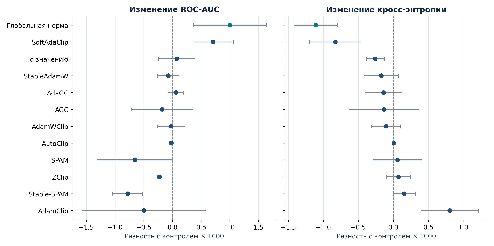
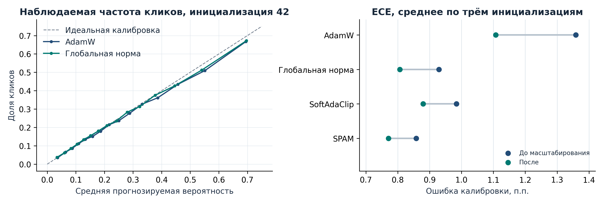
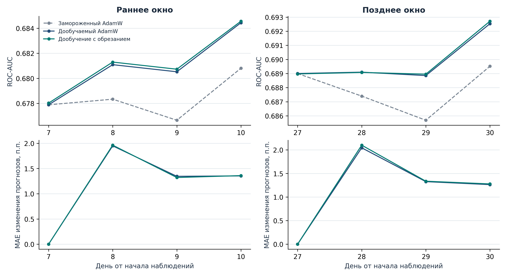
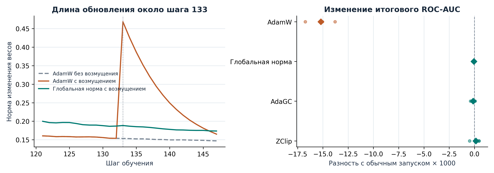

# Исследование алгоритмов обрезания градиентов для прогнозирования кликов

Модель оценивает вероятность клика по признакам рекламного показа. В работе сравниваются методы обрезания градиентов по трём критериям: качество прогноза, калибровка вероятностей и устойчивость обучения. Отдельно проверяется, насколько обрезание помогает при дообучении на свежих данных и при резких всплесках нормы градиента.

[Ноутбук с кодом и результатами](ctr.ipynb)

## Данные

| Датасет | Как использован | Объём |
| --- | --- | --- |
| [Criteo 1M](https://huggingface.co/datasets/eldieguinpo/criteo-1M) | Статическое сравнение | 800 тыс. показов для обучения, 100 тыс. для валидации и 100 тыс. для теста |
| [Criteo Attribution](https://huggingface.co/datasets/criteo/criteo-attribution-dataset) | Дообучение по дням | Два непересекающихся окна по 10 дней, по 300 тыс. показов в день |

Целевая переменная равна 1 при клике. Категориальные признаки кодируются целыми числами. В Criteo 1M числовые пропуски заменяются нулями и отмечаются отдельными признаками. Во временном эксперименте час показа кодируется через sin и cos. Поля, связанные с конверсией и атрибуцией, исключены.



В первом окне CTR вырос с 34,13% на шестой день до 35,95% на десятый. За это время изменились и доли кампаний.

## Модель и условия сравнения

Эмбеддинги категориальных признаков объединяются с числовыми признаками и поступают в MLP со скрытыми слоями шириной 256, 128, 64 и 32. Вероятность клика получается применением сигмоиды к логиту. Функция потерь при обучении представляет собой бинарную кросс-энтропию.

Проверены AGC, AdaGC, AutoClip, ZClip, SoftAdaClip, AdamClip, AdamWClip, StableAdamW, SPAM и Stable-SPAM. Контрольные режимы включают AdamW и Adam без обрезания, обрезание по глобальной норме и по значению. Adam служит отдельным контролем для AdamClip, у которого регуляризация включена в градиент.

В 26 валидационных прогонах подбирали основные параметры по кросс-энтропии. Например, для глобальной нормы порог 0,1 дал 0,48033, порог 0,5 дал 0,48131. После подбора провели 42 тестовых прогона, по три инициализации на каждый из 14 режимов.



## Результаты на Criteo 1M

Средние значения по трём инициализациям на одном тесте. Для ROC-AUC большее значение лучше. Для остальных метрик меньшее значение лучше.

| Режим | ROC-AUC | Кросс-энтропия | Брайер | ECE |
| --- | ---: | ---: | ---: | ---: |
| **Глобальная норма, C = 0,1** | **0,754017** | **0,484123** | **0,158276** | 0,009293 |
| SoftAdaClip | 0,753723 | 0,484401 | 0,158400 | 0,009843 |
| По значению | 0,753092 | 0,484971 | 0,158608 | 0,011225 |
| StableAdamW | 0,752944 | 0,485058 | 0,158652 | 0,011012 |
| AdaGC | 0,753074 | 0,485089 | 0,158661 | 0,012358 |
| AGC | 0,752836 | 0,485096 | 0,158665 | 0,010594 |
| AdamWClip | 0,752991 | 0,485127 | 0,158683 | 0,012412 |
| AdamW | 0,753013 | 0,485228 | 0,158729 | 0,013587 |
| AutoClip | 0,752997 | 0,485237 | 0,158733 | 0,013570 |
| SPAM | 0,752361 | 0,485291 | 0,158708 | **0,008580** |
| ZClip | 0,752792 | 0,485304 | 0,158750 | 0,012658 |
| Stable-SPAM | 0,752235 | 0,485384 | 0,158727 | 0,008735 |
| Adam | 0,729542 | 0,501734 | 0,164838 | 0,019227 |
| AdamClip | 0,729047 | 0,502541 | 0,165164 | 0,022989 |



Глобальная норма уменьшила среднюю кросс-энтропию AdamW на 0,001105. Снижение прошло парную проверку с поправкой Холма для всех трёх инициализаций. При пяти эпохах и отдельно подобранной скорости обучения преимущество порога 0,1 по кросс-энтропии исчезло.

### Калибровка

Для ECE прогнозы делятся на 15 приблизительно равных по размеру групп. В каждой сравниваются средний прогноз и фактическая доля кликов. Температура для масштабирования логитов подбиралась на валидации.



SPAM дал наименьшую среднюю ECE на статическом тесте. Глобальная норма дала лучшую кросс-энтропию. Масштабирование снизило ECE AdamW в статическом тесте с 0,013587 до 0,011076. На будущих днях раннего окна ECE дообучаемого AdamW выросла с 0,005340 до 0,007264.

## Дообучение по дням

В каждом окне первые пять дней используются для начального обучения, шестой день используется для валидации. С седьмого дня сначала рассчитываются прогнозы, затем модель обновляется по меткам этого дня. Замороженная модель с теми же начальными весами служит контролем. Изменение прогнозов измеряется на одних и тех же показах валидационного дня.

| Окно | Замороженный AdamW | Дообучаемый AdamW | Дообучаемый AdamW с глобальным обрезанием |
| --- | ---: | ---: | ---: |
| Раннее | 0,678597 | 0,682016 | 0,682195 |
| Позднее | 0,687535 | 0,690162 | 0,690248 |

В таблице приведён средний ROC-AUC по трём инициализациям и трём дням после первого обновления. В обоих окнах само дообучение дало больший прирост, чем добавление глобального обрезания.



## Выбросы градиента

На пяти заданных шагах градиент умножали на 50. Каждый режим сравнивался со своим обычным запуском при той же инициализации и последовательности батчей.

| Режим | Изменение ROC-AUC | Изменение кросс-энтропии |
| --- | ---: | ---: |
| AdamW | −0,015199 | +0,009708 |
| Глобальная норма | −0,000051 | −0,000014 |
| AdaGC | −0,000127 | +0,000152 |
| ZClip | +0,000135 | −0,000192 |



На возмущённых шагах обновления AdamW были примерно в 3,2 раза длиннее обычных. У трёх методов обрезания отношение осталось близким к единице. Это наиболее заметный эффект обрезания в работе.

## Дополнительные сравнения

При пяти эпохах MLP без обрезания получила ROC-AUC 0,767022, логистическая регрессия на тех же признаках получила 0,765428. При этом у логистической регрессии ECE ниже, 0,003876 против 0,015736. Среди вариантов MLP при пяти эпохах наименьшая средняя кросс-энтропия получилась у SoftAdaClip, 0,475288.

В отдельной проверке шести вариантов реализации на одной инициализации наиболее сильное расхождение обнаружилось у StableAdamW. Вариант с RMS-масштабированием получил ROC-AUC 0,7538, вариант с покомпонентным ограничением получил 0,5179.

## Выводы

- Глобальная норма подходит для первой проверки. Порог 0,1 хорошо показал себя при трёх эпохах на Criteo 1M. При изменении настроек обучения порог стоит проверить на валидации заново.
- При редких крупных градиентах полезно сравнить фиксированный порог с AdaGC и ZClip. В испытании все три метода защитили качество при заданном масштабе выбросов.
- При дообучении стоит отдельно измерять выигрыш над замороженной моделью и проверять калибровку на свежих данных.

## Запуск ноутбука

Откройте [`ctr.ipynb`](ctr.ipynb) в Jupyter. Графики и таблицы уже сохранены. Для повторного запуска установите зависимости в окружение ядра Jupyter.

```sh
python -m pip install -r requirements.txt
```

**Run All** заново обучает AdamW и вариант с глобальным обрезанием на 30 тыс. показов, проверяет их на 5 тыс. показов и строит графики по таблицам основного эксперимента. Код модели, обучения и методов находится в [`src/`](src/). Таблицы собраны в [`data/experiments.json`](data/experiments.json).

В [`data/demo/`](data/demo/) находится предобработанная подвыборка Criteo Research. Категории закодированы, время представлено через sin и cos, строки перенумерованы. Подвыборка распространяется по [CC BY-NC-SA 4.0](https://creativecommons.org/licenses/by-nc-sa/4.0/).
